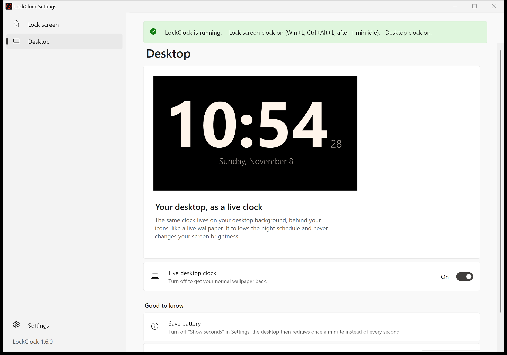
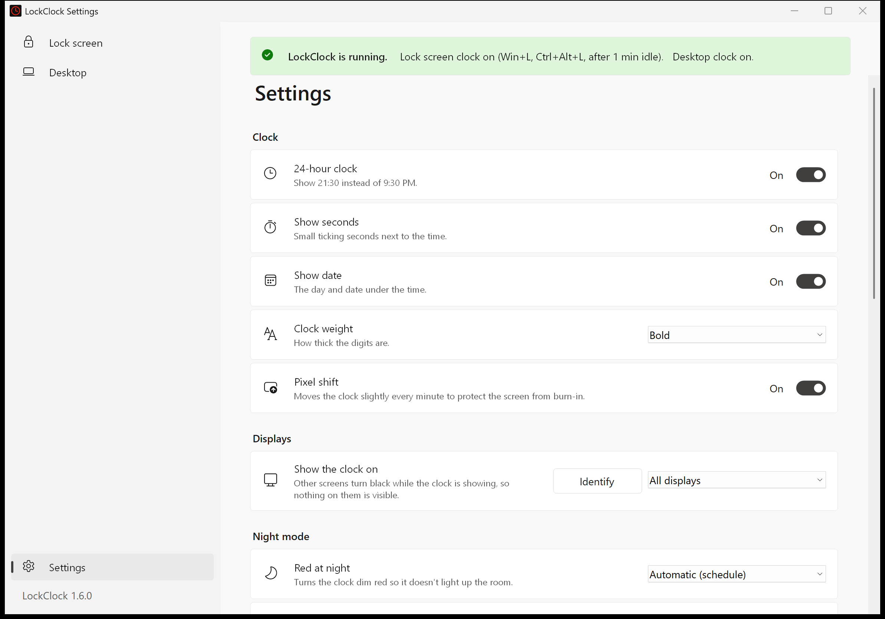
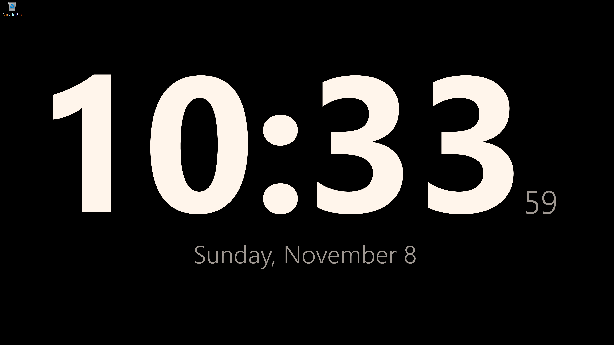

# LockClock 🕰️

**Turn your Windows PC into a beautiful bedside clock.**
LockClock is a giant full-screen clock that takes over your screen when you step away, and turns **soft red at night** (like Apple's StandBy) so you can read the time in the dark without lighting up the room.

Press **Win+L** and the clock appears instantly. Touch anything and Windows locks, taking you straight to the password box.

[](https://github.com/panhavad/lockclock/releases/latest/download/LockClock.msi)
[](https://github.com/panhavad/lockclock/releases/latest/download/LockClock.exe)


---

## Why you'll love it

- 🌙 **Night mode that won't wake you up**: after 21:00 the clock fades to a dim red on pure black, then back to white in the morning (times are adjustable).
- 🔆 **Real screen brightness**: while the clock shows, LockClock sets your screen's actual brightness to your day or night level, using DDC/CI for external monitors and Windows' built-in control for laptop screens. Your normal brightness comes back the moment you touch the PC.
- 🔒 **Replaces the lock screen**: Win+L shows the clock straight away. Any key, click or mouse move locks Windows and goes **straight to the password box**, with no lock-screen picture in between.
- 🖼️ **Live desktop clock**: the same clock can live on your desktop background, behind your icons, like a live wallpaper. It follows the night schedule, never touches your screen brightness, and works on the newest Windows 11 builds.
- ⏱️ **Big, readable, bold**: huge digits sized to your screen, with optional small ticking seconds, 12/24-hour time and the date.
- ⛅ **Weather at a glance**: the current conditions plus today's high/low and a 3-day forecast. It finds your location automatically, or you can type a city.
- 🖥️ **Made for always-on screens**: pure black background, gentle pixel shift against burn-in, keeps the display awake.
- 🖥️🖥️ **Multi-monitor aware**: show the clock on all displays, only the main one, or a display you pick (with an *Identify* button). Other screens go black so nothing on them is visible.
- 👀 **Simple, PowerToys-style app**: two main tabs, **Lock screen** and **Desktop**, each with a live preview and an on/off switch. Every other option lives on one **Settings** page, pinned at the bottom like in PowerToys.
- 🔌 **Kill switches**: turn the lock screen clock or the desktop clock off with one switch. Windows gets its normal lock screen, Win+L, screensaver or wallpaper back, and your choices are kept for when you turn it on again.
- ✅ **Set up once, saves automatically**: click **Set up** the first time and LockClock configures itself. After that, every change saves automatically, just like PowerToys. No digging through Windows screensaver settings.
- 🪶 **Tiny & dependency-free**: a single ~95 KB app built on the .NET Framework that ships with Windows. No runtime to install, no admin needed to install.

| Day | Lock screen tab |
|---|---|
|  |  |

| Desktop tab | Settings |
|---|---|
|  |  |

**On your desktop**, behind the icons:



## Install

1. Download **[LockClock.msi](https://github.com/panhavad/lockclock/releases/latest/download/LockClock.msi)** and run it.
   It installs just for you (no admin rights), sets LockClock as your screensaver, and opens the settings app.
2. Pick your look. Changes save automatically.
3. Optional: on the **Settings** page, under *Lock screen*, turn on **Show the clock when I press Win+L** and **Skip the lock screen picture**. Windows asks for administrator approval once. To get the live desktop clock, turn it on in the **Desktop** tab.

Prefer no installer? Download the portable **[LockClock.exe](https://github.com/panhavad/lockclock/releases/latest/download/LockClock.exe)**, run it, and click **Set up**.

> Windows SmartScreen may warn because the app isn't code-signed yet: click **More info → Run anyway**.

## How to use it

| You do | LockClock does |
|---|---|
| Press **Win+L** *(if enabled)* | Shows the clock instantly; touching anything locks the PC |
| Press **Ctrl+Alt+L** | Same, from the Start Menu shortcut "Lock with Clock" |
| Leave the PC idle | Starts as your screensaver after the wait time you chose |
| Start Menu → **LockClock Settings** | Turn the lock screen or desktop clock on/off, and change the look, displays, night hours, brightness, weather and lock options |

## How it works (and what to know)

Windows doesn't let apps draw on the real lock screen, so LockClock shows the clock *just before* Windows locks:

- A tiny background helper starts when you sign in and watches for Win+L. To let it handle Win+L, LockClock turns on Windows' per-user "disable lock workstation" policy and switches it back off right before it locks the PC. It turns it on again when you sign back in.
- **While the clock is showing, the PC is not locked yet.** The first key press, click, mouse move or focus change (e.g. Ctrl+Alt+Del → Task Manager) locks it immediately. If Windows ever refuses to lock, the clock stays up and tries again.
- While Win+L is taken over, the **Lock** option is hidden from the Ctrl+Alt+Del menu. Win+L, sleep and closing the lid still lock as usual.
- "Skip the lock screen picture" sets the machine policy `NoLockScreen` (honored on Windows Enterprise and Education).
- Real brightness uses DDC/CI for external monitors (some monitors have it switched off in their on-screen menu) and WMI for built-in laptop panels. Your original levels are saved first, so even if the clock is closed unexpectedly, the helper restores them when you sign in. Displays that can't be controlled get dimmed clock colors instead.
- The desktop clock is a separate small process that places the clock behind the desktop icons, the same technique live-wallpaper apps use, including the Windows 11 24H2+ desktop layout. It re-attaches by itself if Explorer restarts or displays change.
- On company-managed PCs, IT policies may override or report these settings.

## Privacy

Weather comes from [Open-Meteo](https://open-meteo.com/) (free, no account). When the City box is blank, your approximate location is looked up from your internet address via [ipapi.co](https://ipapi.co/) (or [ipwho.is](https://ipwho.is/) as a fallback). Type a city to skip that. Turn weather off and LockClock makes no network requests at all. Settings stay in your Windows user profile.

## Uninstall

Settings → Apps → **LockClock** → Uninstall. This stops the helper, gives Win+L back to Windows, and removes the screensaver and shortcuts.
"Skip the lock screen picture" is a machine setting: turn it off in LockClock Settings first if you want the picture back.

## Build from source

Requirements: Windows with .NET Framework 4.x (built in). The MSI step downloads the portable [WiX Toolset 3.14](https://github.com/wixtoolset/wix3) automatically.

```powershell
.\build.ps1      # -> bin\LockClock.scr
.\install.ps1    # build + set up for the current user
.\package.ps1    # -> dist\LockClock.exe and dist\LockClock.msi
.\uninstall.ps1  # remove everything
```

Useful command-line switches: `/c` settings, `/s` screensaver, `/lock` show clock then lock, `/w` windowed, `/install`, `/uninstall`, plus `/night` or `/day` to preview a mode.

## License

[MIT](LICENSE) © panhavad
