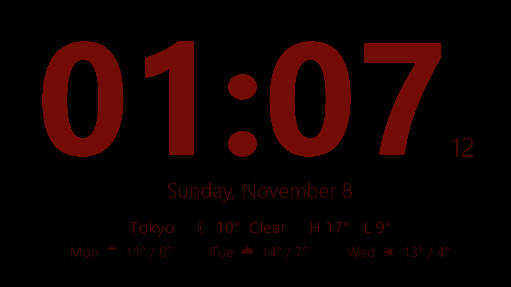
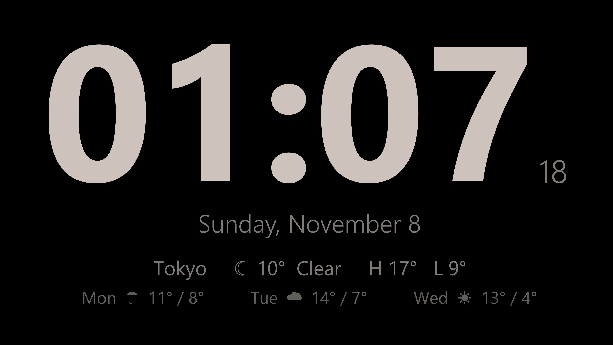
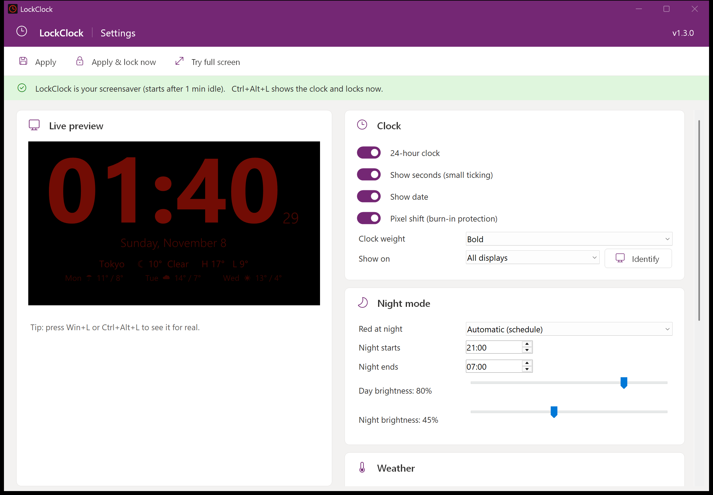

# LockClock 🕰️

**Turn your Windows PC into a beautiful bedside clock.**
LockClock is a giant full-screen clock that takes over your screen when you step away, and turns **soft red at night** (like Apple's StandBy) so you can read the time in the dark without lighting up the room.

Press **Win+L** and the clock appears instantly. Touch anything and Windows locks, taking you straight to the password box.

[](https://github.com/panhavad/lockclock/releases/latest/download/LockClock.msi)
[](https://github.com/panhavad/lockclock/releases/latest/download/LockClock.exe)




---

## Why you'll love it

- 🌙 **Night mode that won't wake you up**: after 21:00 the clock fades to a dim red on pure black, then back to white in the morning (times and brightness are adjustable).
- 🔒 **Replaces the lock screen**: Win+L shows the clock straight away. Any key, click or mouse move locks Windows and goes **straight to the password box**, with no lock-screen picture in between.
- ⏱️ **Big, readable, bold**: huge digits sized to your screen, with optional small ticking seconds, 12/24-hour time and the date.
- ⛅ **Weather at a glance**: the current conditions plus today's high/low and a 3-day forecast. It finds your location automatically, or you can type a city.
- 🖥️ **Made for always-on screens**: pure black background, gentle pixel shift against burn-in, keeps the display awake.
- 🖥️🖥️ **Multi-monitor aware**: show the clock on all displays, only the main one, or a display you pick (with an *Identify* button). Other screens go black so nothing on them is visible.
- 👀 **Live preview**: see every change instantly in a clean, Power Apps–style settings app (Fluent design, toggle switches, day/night preview).
- ✅ **One-click setup**: click **Apply** and LockClock sets itself up. No digging through Windows screensaver settings.
- 🪶 **Tiny & dependency-free**: a single ~70 KB app built on the .NET Framework that ships with Windows. No runtime to install, no admin needed to install.

| Day | Settings with live preview |
|---|---|
|  |  |

## Install

1. Download **[LockClock.msi](https://github.com/panhavad/lockclock/releases/latest/download/LockClock.msi)** and run it.
   It installs just for you (no admin rights), sets LockClock as your screensaver, and opens the settings app.
2. Pick your look and click **Apply**.
3. Optional: tick **Show the clock when I press Win+L** and **Skip the lock screen picture**, then click **Apply**. Windows asks for administrator approval once.

Prefer no installer? Download the portable **[LockClock.exe](https://github.com/panhavad/lockclock/releases/latest/download/LockClock.exe)**, run it, and click **Apply**.

> Windows SmartScreen may warn because the app isn't code-signed yet: click **More info → Run anyway**.

## How to use it

| You do | LockClock does |
|---|---|
| Press **Win+L** *(if enabled)* | Shows the clock instantly; touching anything locks the PC |
| Press **Ctrl+Alt+L** | Same, from the Start Menu shortcut "Lock with Clock" |
| Leave the PC idle | Starts as your screensaver after the wait time you chose |
| Start Menu → **LockClock Settings** | Change the look, night hours, weather and lock options |

## How it works (and what to know)

Windows doesn't let apps draw on the real lock screen, so LockClock shows the clock *just before* Windows locks:

- A tiny background helper starts when you sign in and watches for Win+L. To let it handle Win+L, LockClock turns on Windows' per-user "disable lock workstation" policy and switches it back off right before it locks the PC. It turns it on again when you sign back in.
- **While the clock is showing, the PC is not locked yet.** The first key press, click, mouse move or focus change (e.g. Ctrl+Alt+Del → Task Manager) locks it immediately. If Windows ever refuses to lock, the clock stays up and tries again.
- While Win+L is taken over, the **Lock** option is hidden from the Ctrl+Alt+Del menu. Win+L, sleep and closing the lid still lock as usual.
- "Skip the lock screen picture" sets the machine policy `NoLockScreen` (honored on Windows Enterprise and Education).
- On company-managed PCs, IT policies may override or report these settings.

## Privacy

Weather comes from [Open-Meteo](https://open-meteo.com/) (free, no account). When the City box is blank, your approximate location is looked up from your internet address via [ipapi.co](https://ipapi.co/) (or [ipwho.is](https://ipwho.is/) as a fallback). Type a city to skip that. Turn weather off and LockClock makes no network requests at all. Settings stay in your Windows user profile.

## Uninstall

Settings → Apps → **LockClock** → Uninstall. This stops the helper, gives Win+L back to Windows, and removes the screensaver and shortcuts.
"Skip the lock screen picture" is a machine setting: untick it in LockClock Settings first if you want the picture back.

## Build from source

Requirements: Windows with .NET Framework 4.x (built in). The MSI step downloads the portable [WiX Toolset 3.14](https://github.com/wixtoolset/wix3) automatically.

```powershell
.\build.ps1      # -> bin\LockClock.scr
.\install.ps1    # build + set up for the current user
.\package.ps1    # -> dist\LockClock.exe and dist\LockClock.msi
.\uninstall.ps1  # remove everything
```

Useful command-line switches: `/c` settings, `/s` screensaver, `/lock` show clock then lock, `/w` windowed, `/install`, `/uninstall`, plus `/night` or `/day` to preview a mode.

## License

[MIT](LICENSE) © panhavad
